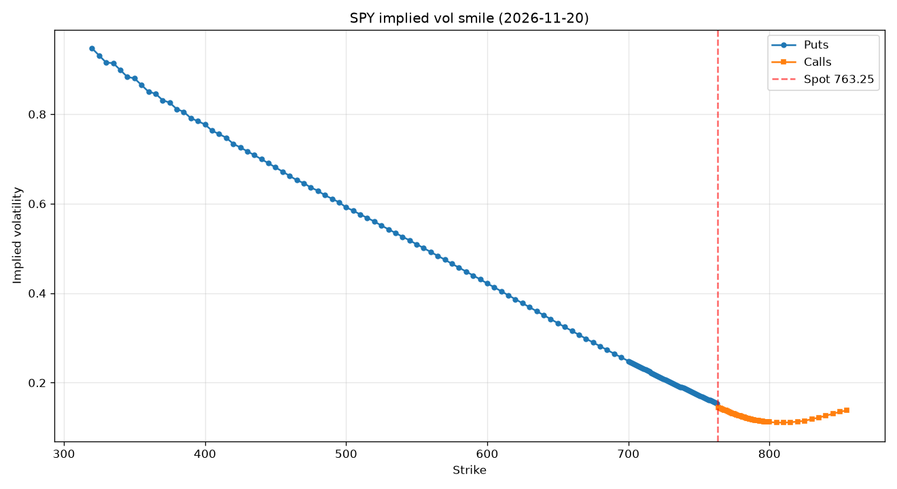
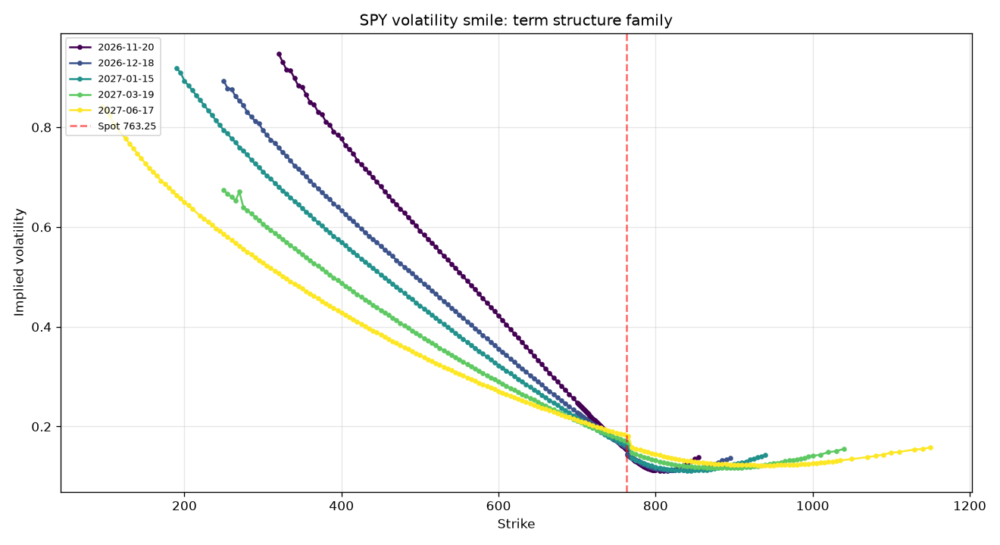
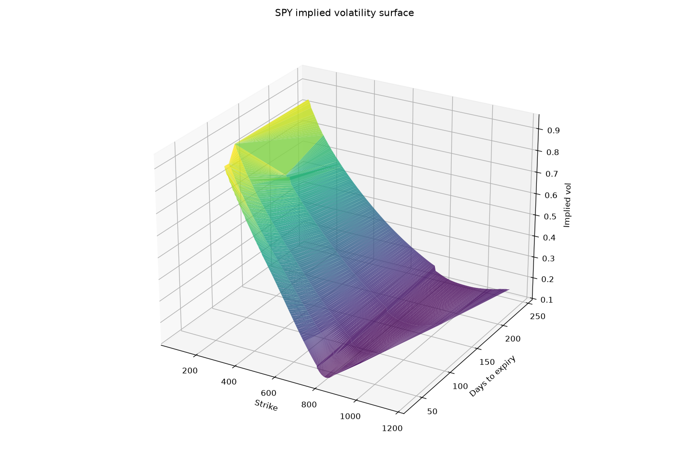

[](https://volatility-surface-3qwrckrlldquymzv6xnwzo.streamlit.app/)

# Volatility Surface

Fit an implied volatility surface from real SPY option chains, analyze the
smile and term structure, and check for no-arbitrage violations.

## Live demo

**Try it here:** [https://volatility-surface-3qwrckrlldquymzv6xnwzo.streamlit.app/](https://volatility-surface-3qwrckrlldquymzv6xnwzo.streamlit.app/)

The deployed app loads a precomputed surface snapshot (so it works
offline) and lets you drag to rotate the 3D surface, adjust filters, and
compare smile curves across expiries.

## What this shows

Black-Scholes assumes volatility is a single number. Real markets disagree:
implied volatility varies systematically across **strike** (the smile/skew)
and **maturity** (the term structure). This project constructs the full
implied volatility surface from a real SPY option chain and analyzes it.

Two things matter:

1. **The shape** — equities have a pronounced **skew**: OTM puts trade
   richer than OTM calls. This is the market's crash-insurance premium.
2. **The validity** — a fitted surface must be **arbitrage-free**. We check
   butterfly convexity, calendar monotonicity, and vertical spread bounds.

## Key findings

### The smile has a pronounced skew



For the 30-day expiry, implied vol ranges from ~0.25 at ATM up to
~0.50 at deep OTM puts — a classic equity-index skew.

### Short-dated smiles are steeper



The same smile across 5 maturities. Short expiries have a steeper smile
(higher gamma, sharper risk premium); longer expiries flatten out.

### The 3D surface



Strike on X, days to expiry on Y, implied vol on Z.

### No-arbitrage checks

| Check | What it detects | Result |
|---|---|---|
| **Butterfly** | ∂²C/∂K² < 0 | Small violations (~1e-3), expected on real data |
| **Calendar** | σ²·T decreases with maturity | Occasional violations at stale strikes |
| **Vertical bounds** | Call prices not monotone in strike | Clean across all expiries |

Vertical-bound violations being zero is the strongest signal: it confirms
the IV solver is producing sensible prices. Small butterfly and calendar
violations are normal for raw market data.

## Method

1. **Fetch chain** via yfinance for 5+ SPY expiries
2. **Clean quotes** — drop zero-bid, crossed, zero-OI strikes
3. **Combine** — OTM puts below spot, OTM calls above (avoids illiquid ITM)
4. **Invert IV** — Newton-Raphson with brentq fallback
5. **Filter** — IVs outside [0.02, 1.5] and mid price < $0.05 dropped
6. **Stack** — assemble (T, K, IV) grid
7. **Validate** — butterfly, calendar, vertical-bound checks

## Project structure

```
volatility-surface/
├── src/
│   ├── data.py           # yfinance chain fetch
│   ├── black_scholes.py  # Reused from options-pricer
│   ├── implied_vol.py    # Reused IV solver
│   ├── iv_grid.py        # Per-strike IV, smile filtering
│   ├── surface.py        # Multi-expiry surface construction
│   └── no_arbitrage.py   # Butterfly / calendar / vertical checks
├── notebooks/analysis.ipynb
├── results/              # surface_data.csv and PNG plots
├── app.py                # Streamlit + Plotly 3D dashboard
└── requirements.txt
```

## Reproduce locally

```bash
pip install -r requirements.txt
streamlit run app.py
```

Or open `notebooks/analysis.ipynb` to step through the analysis.

## Limitations and next steps

- **Discrete strike grid** — no interpolation between strikes
- **No parametric fit** — SVI or SABR would give a genuinely arbitrage-free surface
- **Single snapshot** — no dynamics, no sticky-strike analysis

Natural extensions:

- **SVI parameterization** — 5-parameter fit per expiry with arbitrage constraints
- **Heston calibration** — fit stochastic vol parameters to the surface
- **Surface dynamics** — track daily surfaces, estimate skew beta to spot

## Skills demonstrated

- Derivatives pricing — Black-Scholes, IV inversion, put-call parity
- Data engineering — live option chains, quote cleaning
- Numerical methods — Newton-Raphson, brentq
- Visualization — matplotlib 3D, Plotly, Streamlit
- Financial reasoning — no-arbitrage, skew, term structure